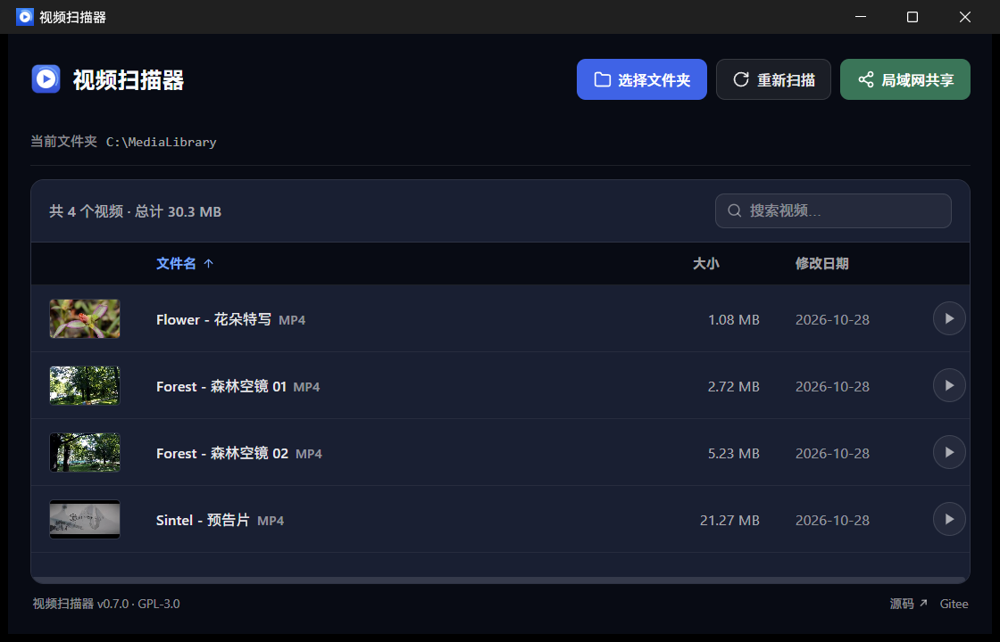
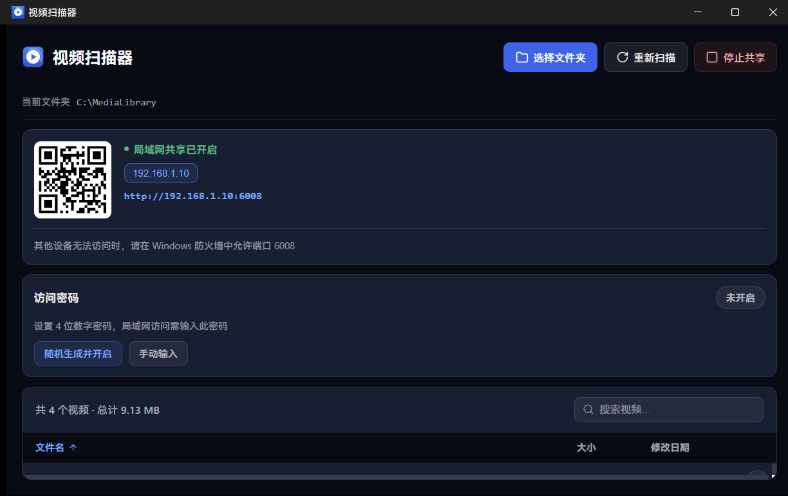
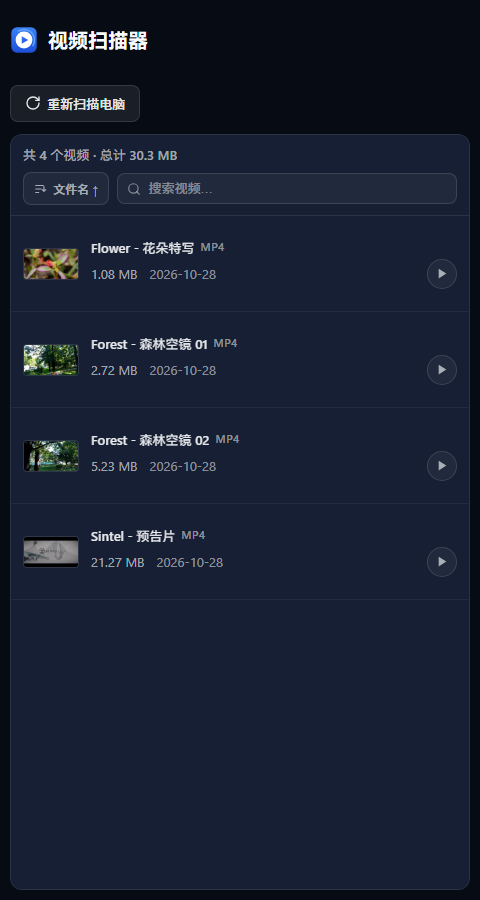
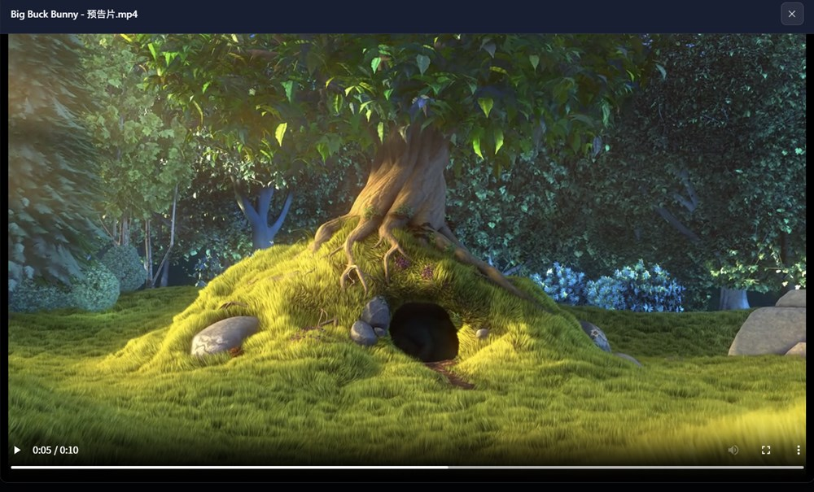
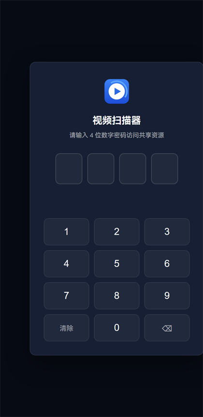

# 视频扫描器

把电脑里某个文件夹的视频整理成一个列表，双击就能在应用里直接播放；也能一键开启
局域网共享，让手机 / 平板 / 电视扫二维码观看。

- **免安装**：下载一个 exe，双击即可运行
- **不上传任何数据**：扫描、播放、共享全部只发生在你的电脑和局域网内，
  不向任何外部服务器发送数据
- 界面为深色主题，上万条视频依然流畅



| 局域网共享面板 | 手机网页端 |
|:---:|:---:|
|  |  |

| 网页端内联播放 | 4 位数字密码登录页 |
|:---:|:---:|
|  |  |

> 截图中的视频为公开示例素材：Flower 与 Sintel 来自 MDN 的 CC 授权示例，
> Sintel 与《Big Buck Bunny》为 Blender 开放电影，Forest 空镜为 samplelib.com
> 的演示片段。共享地址为示例值，与真实网络环境无关。

## 下载

**系统要求：Windows 10 / 11（64 位）。**

1. 打开**当前这个仓库**的 Releases 页面（Gitee 上叫「发行版」）；
2. 下载最新版本中的 `video-scanner-*-windows-amd64.exe`；
3. 双击运行即可，无需安装。

> **GitHub 与 Gitee 各有一份发行版，文件完全相同**：exe 是同一份构建产物（发版时
> 自动传到 Gitee），代码由 Gitee 自动镜像。你在哪个站点看到这份说明，就用那个站点
> 的发行版——两边一模一样，不需要跨站下载。
> Gitee 侧是只读镜像（`https://gitee.com/my_little_world/my-video-go`），
> Issue / 反馈请到 GitHub 仓库提。

版本之间的变化见 [更新日志](CHANGELOG.md)。

> **Windows 弹出"已保护你的电脑"怎么办？**
> 点击**更多信息** → **仍要运行**。本程序没有购买数字签名（签名证书需按年付费），
> Windows 对从网上下载的未签名程序会默认拦截，这不代表程序有问题。
> 个别杀毒软件也可能误报，添加信任即可。

如果打开后提示缺少 WebView2（Windows 11 自带，部分较旧的 Windows 10 没有），
到[微软官网](https://developer.microsoft.com/microsoft-edge/webview2/)免费下载安装
一次即可。

## 快速上手

1. **双击打开**程序，点击右上角**「选择文件夹」**（也可以直接把文件夹**拖进窗口**），
   选中你存放视频的文件夹——会连同子文件夹一起扫描，扫描过程中会显示已检查多少个
   文件，也可以随时取消；
2. 扫描完成后，视频以列表显示，可以按文件名 / 大小 / 修改日期**排序**，也可以**搜索**。
   文件有增删后，点一下顶部的**「重新扫描」**就会重新扫描；
   - 选过一次之后，下次打开会自动回到这个文件夹并重新扫描，不需要再选一遍
3. **双击列表中的视频即可播放**：MP4 / M4V / MKV / WebM / MOV 通常在应用内直接播放，
   可以随意拖进度条；其他格式（AVI / WMV / FLV 等）或个别放不出来的视频，
   会自动改用电脑上的默认播放器打开；
4. **想在手机上看？** 点击**「局域网共享」**，界面上会出现二维码和网址，用手机
   （连着同一个 WiFi）扫码或输入网址即可观看。手机上的列表会自动刷新，
   电脑这边重新扫描后手机无需任何操作；
   - 手机上的按钮是**「重新扫描电脑」**——注意扫描是在**你电脑上**进行的，
     点它会占用电脑的磁盘（大目录可能要几十秒），因此会先弹一个确认框；
     平时**不需要**点它，电脑上重新扫描后手机最多等 30 秒就会自动同步；
   - 手机打不开页面？按界面上的提示在 Windows 防火墙放行端口即可（见
     [常见问题](#常见问题)）；
   - 共享默认使用 6008 端口，被占用时会自动换下一个，以界面上显示的为准；
   - **关闭窗口不会退出程序**——它会收起到右下角托盘（共享开不开都一样，收起来
     不影响正在进行的共享）。要真正退出：右键托盘图标点「退出」。Win11 默认把
     新图标折叠在任务栏的 `^` 里，没看见就点一下它；
5. **（可选）设置访问密码**：开启共享后，界面下方会出现「访问密码」面板。
   设置一个 4 位数字密码，手机访问就需要先输密码（可一键随机生成，生成后旁边有
   「复制」按钮）；
   不想用密码时在这里关闭即可。

## 支持的视频格式

扫描支持：MP4、M4V、MKV、WebM、AVI、MOV、WMV、FLV、MPG / MPEG。

其中 MP4 / M4V / MKV / WebM / MOV 通常能在应用内直接播放，其余格式自动调用
系统播放器。注意：能否内联播放最终取决于文件内的编码——同样是 MKV，个别编码的
视频轨 / 音轨可能放不出来，此时同样会自动转给系统播放器，不会"双击没反应"。

小于 1 MB 的文件（下载残留、损坏的空壳文件）不会进入列表，但扫描完成后界面上
会明确提示跳过了哪些文件，不会静默消失。

## 隐私与安全

- **不上传任何数据**：程序不向任何服务器发送数据，扫描结果、播放记录都只在你本机。
  本机只写三个文件，都在 `%AppData%\video-scanner-go`：`settings.json`（上次扫描的
  文件夹，用来在下次打开时自动恢复列表）、`password_config.json`（密码的哈希材料，
  首次启动就会生成）、`video-scanner.log`（出错时的日志，超过 1 MiB 轮转一次）
- 共享是**只读**的：手机只能看列表和播放视频，不能上传、删除、改名；
  共享目录里的非视频文件也无法被访问或下载
- 手机端看不到文件的完整路径，只能看到文件名
- 访问密码以 **Argon2id 哈希**（不可逆，程序自己也读不回明文）保存在
  `%AppData%\video-scanner-go`；局域网登录同一 IP 每 30 秒最多尝试 3 次，输错会
  短暂锁定——4 位密码只有 1 万种，限流把尝试速度压到约每小时 360 次
- 局域网共享是明文 HTTP，适合家庭网络使用；请不要在公共 WiFi 下开启共享
- **已知取舍**：桌面端为了能拖进度条、又不把整个视频读进内存，从**程序启动起**就在
  本机回环地址（`127.0.0.1` 的随机端口）上跑一个小服务器，把视频流喂给播放器。
  它**不校验访问密码**，所以只要程序还在运行（开不开共享都一样），同一台电脑上
  的其他程序或用户会话就能绕过密码读取列表里的视频。它只监听回环地址，局域网里的
  其他设备连不上；想消掉这个面只能退出程序——关掉「局域网共享」不会停掉它

## 常见问题

**手机扫码后打不开页面？**
确认手机和电脑连的是同一个 WiFi / 路由器；然后按共享面板下方的提示，在 Windows
防火墙中放行对应端口。家庭网络一般没问题，公司 / 学校网络常常禁止设备之间互访。

**双击视频转圈很久或没有画面？**
应用检测到播放失败会自动改用系统播放器打开，稍等几秒即可。个别编码特殊的文件
（如 HEVC、AC3 音轨）webview 解不了，都会走这条回退路径。

**杀毒软件报毒 / Windows 拦截？**
见[下载](#下载)一节的说明：程序未购买数字签名，属于未签名程序的常见待遇，
点击"仍要运行"或添加信任即可。

**别人能看到我的视频列表吗？**
只有你点了「局域网共享」之后，同一网络内的设备才能访问；没开共享时，一切都
只在你电脑上。设置了访问密码的话，对方还必须输对密码。

**支持 macOS / Linux 吗？**
暂不支持，目前只提供 Windows 版本。

## 面向开发者

<details>
<summary><b>构建与开发</b>（点开）</summary>

依赖：Go 1.27.2+、Node 22+、pnpm 11、[Wails v3 CLI](https://v3.wails.io)、WebView2 运行时
（Windows 11 自带，构建不需要、运行需要）。Go 版本以 `go.mod` 为准——`go` 指令带补丁号，
1.27.0 / 1.27.1 会直接拒绝构建。

```bash
# 安装 Wails v3 CLI（钉在与 go.mod/CI 相同的 v3.0.0，避免 CLI 与库版本错配）
go install github.com/wailsapp/wails/v3/cmd/wails3@v3.0.0

# 开发（前端热重载 + Go 重编译）
wails3 dev

# 构建产物（先构建 frontend/dist，再产出 build/bin/视频扫描器.exe）
wails3 build

# 只构建前端（改样式 / 组件后想让网页端生效时）
pnpm -C frontend install && pnpm -C frontend build

# 质量检查（与 CI 同款，少跑一项就可能"本地全绿、CI 红灯"）
pnpm -C frontend check           # svelte-check + 跨文件一致性断言
gofmt -l .                       # 必须无输出
go vet ./...
go run honnef.co/go/tools/cmd/staticcheck@v0.8.2 ./...
go test -race ./...              # -race 需要 CGO/gcc（CI 的 windows-latest 自带 MinGW）
```

`wails3 build` 产出 `build/bin/视频扫描器.exe`，可执行文件即绿色版，无需安装。
构建任务是 `Taskfile.yml` 里的 task（v3 用 Taskfile 做编排）；v2 的 `wails.json` 在 v3
里换成了 `build/config.yml`（产品名、版本号等元数据在那里，exe 的版本资源仍由
`build/windows/info.json` 决定）。

</details>

<details>
<summary><b>架构速览</b>（点开）</summary>

Go + Wails v3 桌面应用 + Svelte 5（纯 Vite，无 SvelteKit）。只有一份前端构建产物：
桌面端由 Wails 资产服务加载（经 `Call.ByName("main.App.<方法>")` 调 Go 服务），网页端
由内嵌 HTTP 服务器发给局域网浏览器（数据走 `/videos` 等 JSON 接口）。两端的差异全部
收敛在 `frontend/src/lib/platform/` 环境抽象层，组件只依赖统一的接口与能力标志。

```
main.go / app.go           Wails 应用与绑定方法集（Call.ByName "main.App.*"）
internal/
  ├── scanner/             目录扫描（扩展名白名单、1MiB 报告制过滤、取消）
  ├── password/            Argon2id、session、IP 限流、配置持久化
  ├── share/               内嵌 HTTP 服务器（鉴权、列表 ETag、Range 流式、登录页）
  ├── player/              桌面端内联播放专用的本机回环 HTTP 服务器
  ├── state/               全局状态（原子替换的列表快照 + ETag、服务器状态机）
  └── ...
frontend/                  Svelte 5 + Vite（桌面端与网页端共用同一份构建产物）
  └── src/lib/platform/    环境抽象层：desktop.ts（Wails 绑定）/ web.ts（HTTP）
scripts/                   跨文件一致性守卫（check-config-sync / check-web-build）
docs/api.md                网页端 HTTP 接口契约
```

设计要点：

- **相对路径贯穿前后端**：前端只拿 `relative_path`，桌面端播放走本机回环 HTTP
  服务器（127.0.0.1 随机端口，规避 Wails 资产服务在 Windows 上全量缓冲响应体的
  限制，wails#5047）、网页端走 HTTP 端点，两侧共用同一套路径校验 / 扩展名白名单 /
  Range 实现
- `http.ServeContent`（标准库）处理 Range / 416 / Content-Range，`http.Server.Shutdown`
  优雅停止，没有手写的 worker 池与停止信号机制
- 前端产物无内联脚本，浏览器端 CSP 用 `script-src 'self'` 即可，无需 nonce 注入
  （登录页模板除外，仍按每请求随机 nonce）

更多约束与坑见 [AGENTS.md](AGENTS.md)；HTTP 接口契约见 [docs/api.md](docs/api.md)。

</details>

## 背景

该项目是本人 [my-video-tauri](https://github.com/ramen1024/my-video-tauri)
（Tauri 2 + Rust 版）的同功能 Go 重写版：功能对等，工程实现按 Go 的习惯重新设计。

## 许可证

GPL-3.0。详见 [LICENSE](LICENSE)。
